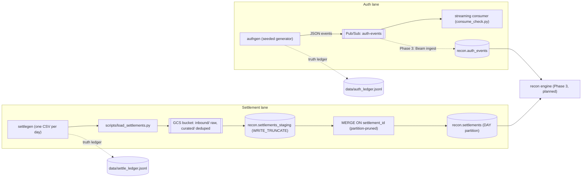

# Architecture — card-auth-settlement-recon

A card authorization ↔ settlement reconciliation platform.
This file records what exists, what it guarantees, and what comes next — in
plain English, so a reviewer can audit the design in ten minutes.

**Status:** Phase 2 complete (settlements landing). Phase 3 (recon engine)
not started.

## The system in one picture

## Components (what exists today)

| Component | Path | What it does |
|---|---|---|
| authgen | `src/authgen/` | Generates card auth events from a fixed seed. Appends every event to `data/auth_ledger.jsonl`. |
| streaming consumer | `streaming/`, `scripts/consume_check.py` | Reads from the Pub/Sub topic `auth-events`; proves the end-to-end flow. |
| settlegen | `src/settlegen/` | Turns approved auths into settlement CSVs, one file per day. Appends truth to `data/settle_ledger.jsonl`. Anomaly tags live only in the ledger, never in the CSV. |
| settlements loader | `scripts/load_settlements.py` | Local gates → GCS → staging → one idempotent MERGE into `recon.settlements`. |
| terraform | `infra/gcp/` | `main.tf`: project services, Pub/Sub topic + subscription, `recon` dataset, `auth_events`, dead-letter table. `settlements.tf`: settlements bucket, `recon.settlements`, `recon.settlements_staging`. |
| CI | `.github/workflows/ci.yml` | 3 jobs; lint and tests gate every push. |
| tests | `tests/` | 33 tests: 17 pipeline, 16 loader gates and SQL shape. |

The Phase 0–1.5 Azure implementation is archived under `infra/azure/` — kept
as evidence, no longer maintained.

## The decisions that shape everything

| Rule | Meaning | Where it lives |
|---|---|---|
| ADR-001 | Money is an integer in the smallest unit (`amount_minor`, `fee_minor`). No floats, anywhere. | generator, BigQuery schemas |
| ADR-002 | The truth ledger is a local JSONL file. Exchange CSVs carry business columns only — no anomaly column. | `data/*_ledger.jsonl` |
| ADR-006 | Sinks sit behind one interface. The cloud is a swappable detail, not the design. | `src/` sink abstraction |
| ADR-014 | Phase 0–1.5 ran on Azure. Current target is GCP: Pub/Sub → Beam → BigQuery. | `infra/` |
| N-14 | Exactly-once is a property of the **destination**, not the source. The MERGE on `settlement_id` absorbs retransmissions. | loader, recon design |

## The idempotency chain

How a retransmitted file changes nothing:

1. **In-file gate.** Same `settlement_id` with a byte-identical payload →
   absorbed and counted. Same id with a different payload → loud stop,
   exit 1, nothing loads.
2. **Curated copy.** The deduped CSV lands in `gs://<bucket>/curated/…`.
   The raw file lands in `gs://<bucket>/inbound/…` as provenance. Staging
   is loaded from curated only — duplicate source rows would double-insert.
3. **Staging is WRITE_TRUNCATE.** A failed run leaves no half state.
4. **One MERGE** on `settlement_id`, pruned to the file's own dates
   (`T.settlement_date IN (DATE '…')`), so the scan touches only the
   partitions this batch can name.
5. **Row arithmetic.** Post-merge count must equal pre-count + inserts,
   else exit 1.
6. **Proof.** Run the same command twice. Run 2 must print `inserted=0`
   and an unchanged digest (count + `BIT_XOR` fingerprint of the touched
   partitions).

**Contract behind the pruning:** one `settlement_id` maps to one
`settlement_date`, forever. True because settlegen writes one day per file
and the gate rejects conflicts. If that contract ever breaks, drop the date
filter from the ON clause and accept the full scan.

## Why these details

- **Partition pruning.** `recon.settlements` is DAY-partitioned on
  `settlement_date`. MERGE and digest read only the partitions named in the
  incoming file; scan cost stays flat as history grows.
- **`BIT_XOR` digest, not `SUM`.** SUM of uniform INT64 fingerprints
  overflows within tens of rows (BigQuery raises Integer Overflow). XOR
  cannot overflow and is just as change-sensitive.
- **Audit columns on INSERT only.** `ingested_at` and `source_file` are
  destination-generated (the file does not get to claim its own ingestion)
  and first-write. A retransmission must not move them, or the digest would
  move too.
- **Money never floats.** INT64 minor units end to end, generator to table.
- **No hardcoded environment.** Flags `--project --dataset --bucket` beat
  env vars (`GCP_PROJECT_ID`, `BQ_DATASET`, `GCS_SETTLEMENT_BUCKET`) beat
  demo defaults.

## Verification gates (evidence, not trust)

| Gate | Command | Passes when |
|---|---|---|
| Lint | `ruff check .` | "All checks passed" |
| Tests | `pytest -q` | 33 passed |
| Local gates | `load_settlements.py --dry-run` | gates pass, zero cloud calls |
| Infra plan | `terraform -chdir=infra/gcp plan` | no unexpected destroys in the plan line |
| Idempotency | run the loader twice | run 2: `inserted=0`, digest unchanged |

## What comes next

**Phase 3 — recon engine.** Join `recon.settlements` against
`recon.auth_events` on `auth_id`, detect the six anomaly classes from the
data itself (MISSING, DUPLICATE, PARTIAL, AMOUNT_MISMATCH, FX_DRIFT,
LATE_T5), and emit a recon report under the same evidence discipline. The
Beam ingest of the auth stream into `recon.auth_events` comes first.
